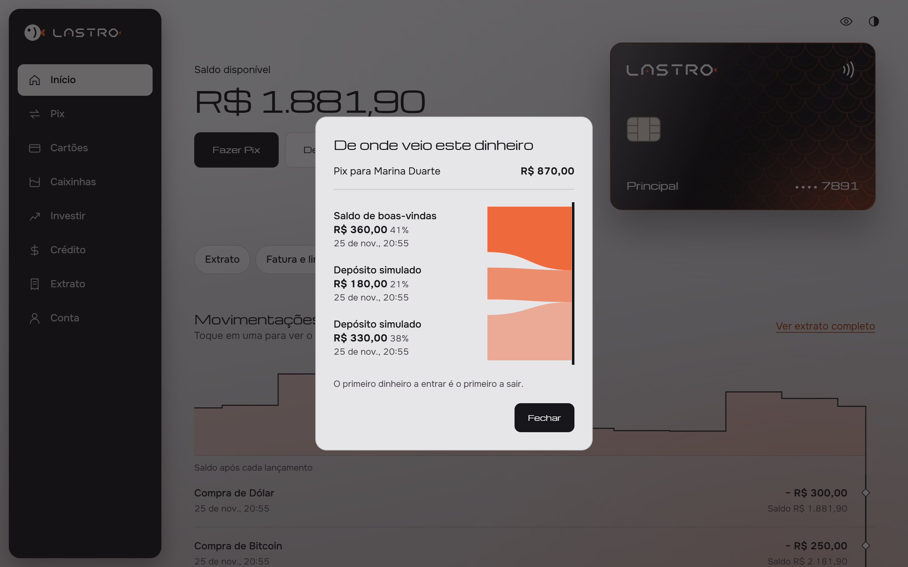
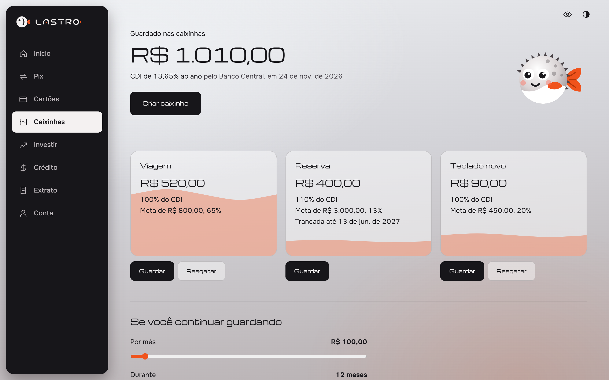
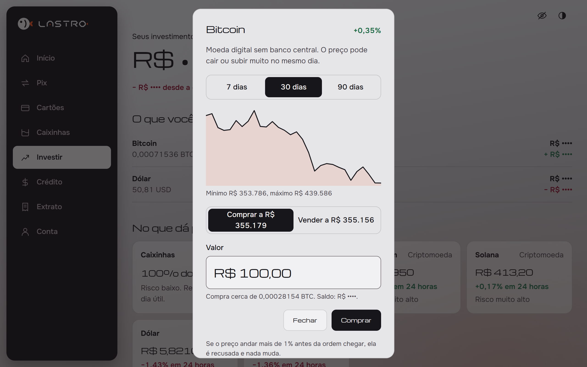

# Lastro Bank

Banco digital de demonstração em **Java**, **Go**, **PostgreSQL** e **React**. Todo o dinheiro é
fictício.

> Em construção: a base do `core-bank` e o site já funcionam. O andamento está no fim da página.

## Telas


| Celular | Tablet | PC |
|---|---|---|
|  |  |  |

As imagens são geradas do app de verdade com `npm run capturas`, que também confere se alguma tela
vaza em 360 px, celular, tablet e PC.

## Rastro

Toque em um lançamento e veja **de onde veio aquele dinheiro**, centavo por centavo. Como o razão
guarda cada entrada e saída, uma função SQL segue o dinheiro na ordem em que ele entrou.



## Caixinhas

Cada caixinha é um aquário que enche até a meta, e o Lino infla conforme você guarda.



## Investimentos



## Crédito


## O que já funciona

- **Pix interno** com chaves, limite diário e noturno, e comprovante. Enviar duas vezes o mesmo pedido
  move o dinheiro uma vez só.
- **Peixe-beta em WebGL puro.** Corpo e nadadeiras calculados na placa de vídeo, sem biblioteca 3D.
- **Caixinhas com CDI real.** A taxa vem do Banco Central e o rendimento entra no razão a cada dia
  útil, sem perder fração de centavo e sem pagar o mesmo dia duas vezes.
- **Crédito de verdade no razão.** O que o cliente deve é o saldo negativo de uma conta própria, e o
  PostgreSQL recusa passar do limite. Fatura fecha dia 25 e vence dia 5, com compras parceladas.
- **Converter limite em saldo**, com a taxa mostrada antes e cobrada só se for a mesma.
- **Empréstimo pela tabela Price.** Quitar antes tira os juros dos meses que não chegaram.
- **Investimentos com cotação real** de bitcoin, ethereum, solana, dólar e euro, com gráfico, custo
  médio e notícias. Ordem recusada se o preço andar mais de 1% entre a tela e a execução.
- **Carteira 3D.** Três cartões que giram, flutuam e viram, com bloqueio e troca do principal.
- **Um app em três formatos**, instalável, com tema claro e botão para esconder valores.
- **Razão contábil em partidas dobradas.** O próprio PostgreSQL recusa lançamento desbalanceado,
  alterado ou apagado, saldo negativo e saldo mudado por fora.
- **Concorrência segura.** Contas travadas em ordem fixa: 200 movimentos cruzados em paralelo
  mantêm a soma e não entram em deadlock.
- **Idempotência.** Depósitos iguais enviados ao mesmo tempo viram um só.
- **Login.** Senha com Argon2id, JWT RS256 com JWKS, renovação rotativa que derruba a sessão se um
  token for reutilizado, e bloqueio após 5 erros.
- **Extrato** com cursor e saldo acumulado por window function.
- **Erros** no padrão RFC 9457, com código estável e `traceId`.

## Rodar

Precisa do JDK 25 e do Node 22.12 ou mais novo. O PostgreSQL vem embutido, sem Docker.

No Windows, dê dois cliques em `iniciar.cmd`: ele sobe a API e o site e abre
`http://localhost:5173`.

Para rodar só a API e os testes dela:

```powershell
cd core-bank
.\mvnw.cmd test
.\mvnw.cmd spring-boot:test-run
```

A API sobe em `http://localhost:8080`.

| Método | Rota | Função |
|---|---|---|
| POST | `/api/v1/auth/register` | Cadastro; abre conta com R$ 1.000,00 fictícios |
| POST | `/api/v1/auth/login` | Token de acesso e cookie de renovação |
| POST | `/api/v1/auth/refresh` | Renova a sessão |
| POST | `/api/v1/auth/logout` | Encerra a sessão |
| GET | `/api/v1/accounts` | Contas do cliente |
| GET | `/api/v1/accounts/{id}` | Uma conta |
| POST | `/api/v1/accounts/{id}/deposits` | Depósito simulado (exige `Idempotency-Key`) |
| GET | `/api/v1/accounts/{id}/statement` | Extrato paginado |
| GET | `/api/v1/cards` | Cartões do cliente |
| PATCH | `/api/v1/cards/{id}` | Bloquear, aproximação ou tornar principal |
| GET | `/api/v1/accounts/{id}/entries/{id}/trace` | Rastro de um lançamento |
| GET, POST | `/api/v1/pix/keys` | Chaves do cliente |
| DELETE | `/api/v1/pix/keys/{id}` | Excluir chave |
| POST | `/api/v1/pix/lookup` | Conferir quem vai receber |
| GET | `/api/v1/pix/limits` | Quanto ainda pode sair agora |
| POST | `/api/v1/pix/transfers` | Enviar Pix (exige `Idempotency-Key`) |
| GET, POST | `/api/v1/vaults` | Caixinhas e CDI atual |
| POST | `/api/v1/vaults/{id}/deposits` | Guardar (exige `Idempotency-Key`) |
| POST | `/api/v1/vaults/{id}/withdrawals` | Resgatar (exige `Idempotency-Key`) |
| DELETE | `/api/v1/vaults/{id}` | Excluir caixinha vazia |
| POST | `/api/v1/cards/{id}/purchases` | Compra de teste no débito ou no crédito |
| GET | `/api/v1/credit` | Limite e faturas |
| POST | `/api/v1/credit/invoices/{mês}/payments` | Pagar fatura |
| GET, POST | `/api/v1/credit/conversion(s)` | Taxa e conversão de limite em saldo |
| GET, POST | `/api/v1/loans` | Oferta, contratação e parcelas |
| POST | `/api/v1/loans/{id}/payments` | Pagar parcela ou quitar |
| GET | `/api/v1/market`, `/market/{ativo}/history`, `/market/news` | Cotações, histórico e notícias |
| GET, POST | `/api/v1/invest`, `/invest/buy`, `/invest/sell` | Carteira e ordens |
| GET | `/.well-known/jwks.json` | Chave pública dos tokens |

## Andamento

- [x] Base: razão contábil, login, contas, depósito e extrato
- [x] Site e app: identidade, carteira 3D, celular, tablet e PC
- [x] Pix interno e Rastro do dinheiro
- [ ] Boleto, recarga e compras no cartão
- [x] Caixinhas com CDI
- [x] Crédito, fatura, conversão de limite e empréstimo
- [x] Investimentos e notícias
- [ ] Antifraude em Go
- [ ] Chat com IA e atendimento no WhatsApp
- [ ] Bolhas, descontos, outros bancos e aproximação simulada
- [ ] Docker, CI e publicação

O plano completo está em [produto](docs/superpowers/specs/2026-11-24-lastro-v2-produto.md) e na
[especificação base](docs/superpowers/specs/2026-11-24-lastro-bank-design.md).
